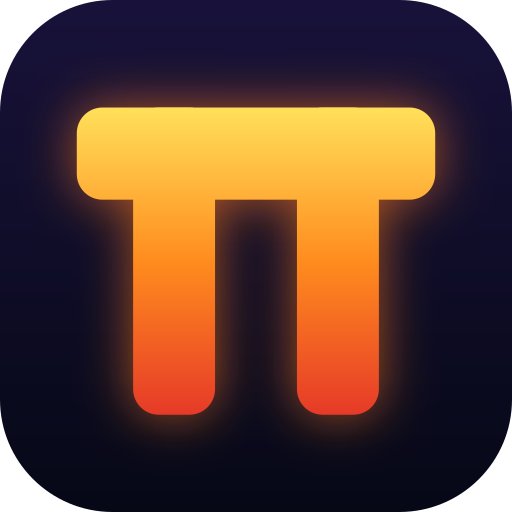

<p align="center"></p>

# Prometheus

A remote-desktop application, inspired by RustDesk, built around
one rule: **the person at the shared computer decides, every time.** Rust,
Tauri 2, H.264 video, an end-to-end encrypted channel (Noise), direct or
relayed connections.

**Status: a working prototype, version 0.1.0.** Milestones 1 to 10 are built
and documented. It has been tested on **one computer** (loopback, its own
Wi-Fi address, and a Linux relay in WSL with simulated delay, loss and
bandwidth limits). It has **not been tested across two separate computers
or the internet**, has had **no independent security review**, and the
installer is **not code-signed**. Read `docs/SECURITY.md` before relying on
it.

*Prometheus (Προμηθεύς), who took fire from the gods and gave it to people.
The logo is his initial, **Π**. The project was called "Remote Control" for
Milestones 1 to 10, and the milestone records in `docs/` still use that name
for what they measured. Settings and keys now live in `%APPDATA%\Prometheus`
(a copy made under an older name is not picked up) and received files go to
`Downloads\Prometheus`. The labels inside the key and handshake derivations
still say "RemoteControl" on purpose: changing them would change what
identities and codes compute. (Not to be confused with the Prometheus
monitoring system, which is unrelated.)*

## Download and install (the easy way)

Go to the **[Releases page](https://github.com/MadhurSikarwar/remote-desk/releases/latest)** and download the file
for your system. No account is needed.

| You have | Download | Then |
|---|---|---|
| **Windows 10/11** | [`Prometheus-setup-windows-x64.exe`](https://github.com/MadhurSikarwar/remote-desk/releases/latest/download/Prometheus-setup-windows-x64.exe) | Double-click it. Installs for your user, no administrator rights |
| Windows, no install | [`Prometheus-portable-windows-x64.exe`](https://github.com/MadhurSikarwar/remote-desk/releases/latest/download/Prometheus-portable-windows-x64.exe) | Double-click it. Nothing is installed; delete the file to remove it |
| **macOS** (Apple Silicon) | [`Prometheus-macos-apple-silicon.dmg`](https://github.com/MadhurSikarwar/remote-desk/releases/latest/download/Prometheus-macos-apple-silicon.dmg) | Open it, drag Prometheus to Applications, then right-click the app and choose **Open** |
| **Linux** (x86_64) | [`Prometheus-linux-x64.AppImage`](https://github.com/MadhurSikarwar/remote-desk/releases/latest/download/Prometheus-linux-x64.AppImage) or [`.deb`](https://github.com/MadhurSikarwar/remote-desk/releases/latest/download/Prometheus-linux-x64.deb) | AppImage: `chmod +x` it and run it. Deb: `sudo apt install ./Prometheus-linux-x64.deb` |

Every release also has `SHA256SUMS.txt` to check your download
(`Get-FileHash <file>` on Windows, `shasum -a 256 <file>` on macOS and Linux).

**The files are not code-signed**, so Windows will warn (**More info**, then
**Run anyway**) and Smart App Control blocks unsigned programs outright; macOS
refuses until you right-click and choose Open. See "If Windows blocks it"
below. Only Windows can share its screen so far (see "Which systems").

*If the Releases page is empty, no release has been published yet: use "Get
the program" below, or ask the maintainer to run the **Release** workflow
(Actions tab, Run workflow).*

## Which systems

| | Windows | macOS | Linux |
|---|---|---|---|
| Share this computer's screen, and be controlled | **yes** | not yet | not yet |
| View and control a shared screen | yes | built, **untried** | built, **untried** |
| Package | installer | `.dmg` (Apple Silicon) | `.deb`, `.AppImage` |

The macOS and Linux builds compile, pass lint and tests on CI and produce
packages, but nobody has run them yet, and they cannot share their own screen
(that needs a different capture, encoder and input method on each system).
Details, limits and the plan: `docs/PLATFORMS.md`. The optional relay server
runs on Linux.

## What it does

- Share a display; a viewer sees it (H.264, about 30 frames per second).
- The host approves each session, comparing a six-digit code with the
  viewer. Nothing is captured before that.
- Optional, each switched on by the host: mouse and keyboard control,
  clipboard text sync, file transfer (each file accepted by its receiver).
- Connect by address, by finding devices on the local network, or by device
  ID through an optional server (direct when possible, relayed otherwise).
- Notices dead connections within 15 s, reconnects (with a new approval),
  and slows the picture instead of falling behind on a slow link.

What it does **not** do: unattended access, start with Windows, run in the
background or hidden, run commands remotely, record, or carry audio.

## Install on another computer (step by step)

Use this to try Prometheus between two Windows computers. **You need it on
both**: one is the *host* (its screen is shared), one is the *viewer*.

### Before you start

- Both computers: **Windows 10 or 11, 64-bit**. (Only Windows can *share*
  its screen so far; a Mac or Linux computer can be the *viewer*, but that is
  untried: see `docs/PLATFORMS.md`.) The window needs Microsoft's
  *WebView2 Runtime*, which Windows 11 and an up-to-date Windows 10 already
  have (the installer fetches it if it is missing; the portable file below
  does not).
- For the simple test, both computers on the **same network** (same Wi-Fi or
  router; not a "guest" network, which often blocks devices from each other).
- You can use any normal Windows account. **No administrator rights are
  needed** to install or run it.

### Step 1. Get the program

Pick **A** or **B**. **The program is not code-signed**, so Windows will warn
(see "If Windows blocks it" below).

**A. The installer** (built and tested by GitHub Actions on a clean machine)

1. Open the repository page, <https://github.com/MadhurSikarwar/remote-desk>,
   and sign in to GitHub (downloads from Actions need a login).
2. Click **Actions**, then the workflow **Installer**, then the newest run
   with a green tick on `main`.
3. At the bottom, under **Artifacts**, download **windows-installer** and
   unzip it. Inside: `Prometheus_0.1.0_x64-setup.exe` and `SHA256SUMS.txt`.
4. Check the file was not damaged: in PowerShell run
   `Get-FileHash .\Prometheus_0.1.0_x64-setup.exe` and compare the value with
   `SHA256SUMS.txt`.
5. Double-click the installer. It installs for your user only (into
   `%LOCALAPPDATA%\Prometheus`) and puts a shortcut in the Start menu and on
   the Desktop. It does not start with Windows and installs no service.

**B. The portable file** (no installer; copy one file)

1. On the computer where the project was built, take `dist\Prometheus.exe`
   (about 11 MB) and `dist\SHA256SUMS.txt`. Copy them to the other computer
   with a USB stick, a shared folder or any cloud drive.
2. On the other computer, check it: `Get-FileHash .\Prometheus.exe` must
   match `SHA256SUMS.txt`.
3. Put it in a folder you like and double-click it. Nothing is installed.

(`dist\` is made on the build computer and is not part of the repository. To
make it again: `cargo build --release`, then copy
`target\release\rc-desktop.exe` to `dist\Prometheus.exe`.)

**C. Build it yourself** on the other computer: install Rust (rustup), the
Visual Studio Build Tools with the "Desktop development with C++" workload,
and Git; then `git clone` this repository and run
`cargo build --release --locked`. The program is
`target\release\rc-desktop.exe`.

### If Windows blocks it

- **"Windows protected your PC" (SmartScreen):** click **More info**, then
  **Run anyway**. This appears because the file is not signed, not because
  anything was found in it.
- **Smart App Control** (Windows 11, shown under *Windows Security → App &
  browser control*): when it is **On**, it refuses unsigned programs
  completely and there is no "Run anyway". Nothing in this project changes
  that setting for you, and you should decide that for yourself on that
  computer. If it is On, the options are to test on a computer where it is Off
  or in "Evaluation" mode, or to wait until the program is signed.
- **Antivirus** may scan a new unsigned file for a while on first start.

### Step 2. The host: share the screen

On the computer whose screen will be viewed:

1. Start **Prometheus** (Start menu or Desktop shortcut). The first start
   creates this computer's identity key automatically.
2. Scroll to **Settings → Network** and tick **Let other computers connect
   while I am sharing**. For an easier test also set **Direct connection
   port** to `21118` (any free port above 1024; `0` picks a new one each time).
   Press **Save settings**.
3. In **Share this screen**: choose the **Display**. Leave control, clipboard
   and files **off** for now (you will turn them on in Step 4). Press **Start
   sharing**.
4. Windows may ask whether to let Prometheus through its firewall: choose
   **Private networks**, then **Allow access**. (You are the one to decide
   this. If no question appears and the viewer cannot connect, see
   "Connection problems" below.)
5. The window now shows: *"Other computers on your network can reach this one
   at 192.168.x.x:PORT"* and this computer's **Device key**. Keep the window
   open: **closing it ends sharing.**

### Step 3. The viewer: connect

On the other computer:

1. Start **Prometheus**. Go to **View a screen**.
2. Press **Find devices on this network** and wait about 3 seconds. The host
   appears with its name and key. Press **Connect** next to it. (If nothing
   is found, type the address from the host's window, for example
   `192.168.1.20:21118`, into the box and press **Connect**.)
3. The viewer shows *"Waiting for the person at the other device to allow it"*
   and a **six-digit code**.
4. On the **host**, a prompt appears with the viewer's name, key and a
   six-digit code. **The two codes must be identical.** If they differ, press
   **Deny**: something is in between. If they match, press **Allow**.
5. The host's screen appears in the viewer's window.

### Step 4. What to try

Tick the things you want on the host while it is sharing (you can change them
at any time and the viewer is told immediately), and report what you see:

| Try | How | Expected |
|---|---|---|
| Picture | Move windows on the host | Smooth, about 30 frames per second; status line shows the delay |
| Control | Host: tick *Let the viewer control…*. Viewer: tick *Control the shared screen* | Viewer's mouse and keyboard act on the host; untick on the host and it stops at once |
| Clipboard | Host: tick *clipboard sync*. Viewer: tick *Sync clipboard text*. Copy text on one, paste on the other | Text arrives; copy something from a password manager and it should **not** arrive |
| Files | Host: tick *Let files be sent…*. Pick a file on either side | The *receiving* person is asked; the file lands in `Downloads\Prometheus` and Windows marks it as downloaded from the internet |
| Refuse | Offer a file and press Refuse | The sender is told it was refused, nothing is written |
| Dead link | Switch the host's Wi-Fi off for 20 s | Viewer: "No answer from the host…", then "Connection lost… Trying again…" |
| Reconnect | Switch it back on | The host gets a **new** prompt; after Allow the picture returns |
| End | Host: **Stop sharing** (or close the window) | Viewer: "Ended: sharing stopped" |

### Step 5. Tell me what happened

Useful to note: what you tried, what the window said (the red text is
meaningful), the Windows version of both computers, and whether the network
was Wi-Fi or cable. Logs are in `%LOCALAPPDATA%\Prometheus\data\logs` on each
computer (one file per day). They contain devices, addresses, times and file
sizes, never the screen, keys, clipboard text or file names.

### Connection problems

| Symptom | What to check |
|---|---|
| "Find devices" shows nothing | Same network? Host has *Let other computers connect* ticked **and** is sharing? "Let devices on the local network find this one" ticked? Some routers block device-to-device traffic (guest Wi-Fi, "client isolation"). Type the address instead |
| "cannot connect … actively refused" | Host not sharing, or *Let other computers connect* is off, or the port is wrong |
| Times out / no answer | Usually the host's **Windows Firewall**: Prometheus must be allowed on the *Private* profile (and is only reachable if the network is set to Private, not Public). See below |
| "…is not the one you picked" | The device at that address has a different key than the one you chose: stop and check |
| Black or frozen picture | The host is on the lock screen or a Windows security prompt, which cannot be shared |

**Firewall by hand.** If Windows never asked, or you clicked Cancel, an
administrator can allow the program. In an *administrator* PowerShell on the
**host** (this changes a system setting, so do it only if you agree):

```powershell
New-NetFirewallRule -DisplayName "Prometheus" -Direction Inbound -Program "C:\path\to\Prometheus.exe" -Action Allow -Profile Private
```

(Use the real path to the installed `rc-desktop.exe`, normally
`%LOCALAPPDATA%\Prometheus\rc-desktop.exe`, or to the portable file.) Remove it
later with `Remove-NetFirewallRule -DisplayName "Prometheus"`.

**Different networks (not the same Wi-Fi).** That needs the optional relay
server, which has to run on a machine both can reach. See
`docs/DEPLOYMENT.md`. Without it, the two computers must be able to reach each
other directly.

### Removing it

- **Installed (A):** Settings → Apps → Prometheus → Uninstall.
- **Portable (B):** delete `Prometheus.exe`.
- Either way, your settings and key remain in `%APPDATA%\Prometheus`, and the
  window's own data in `%LOCALAPPDATA%\Prometheus` and
  `%LOCALAPPDATA%\dev.prometheus.desktop`. Delete those folders to remove
  everything, including this computer's identity.

More detail on every setting and message: `docs/USER-GUIDE.md`.

## Run a server (optional)

For reaching devices on other networks. Linux, Docker or systemd:

```bash
docker compose -f deploy/compose.yaml up -d --build
```

See `docs/DEPLOYMENT.md`, including the warning that the server has no
accounts: restrict who can reach it.

## Build and test

```powershell
cargo build --release                       # the app: target\release\rc-desktop.exe
cargo test --workspace --locked             # what CI runs
cargo test --workspace --locked -- --include-ignored   # also the tests that need a real desktop
cargo fmt --check
cargo clippy --workspace --all-targets --locked -- -D warnings
node --test apps/desktop/ui/reconnect.test.js apps/desktop/ui-tests/*.test.js
```

The compiler is pinned (`rust-toolchain.toml`). The installer:
`cd apps\desktop; cargo tauri build` (see `docs/RELEASING.md`).

## Layout

| Path | What |
|---|---|
| `apps/desktop` | the application (Tauri shell, sessions, window in `ui/`) |
| `apps/server` | the rendezvous and relay server |
| `crates/rc-capture`, `rc-codec`, `rc-input` | screen capture (DXGI), H.264 (Media Foundation), input injection |
| `crates/rc-crypto`, `rc-net`, `rc-protocol`, `rc-rendezvous` | keys and the encrypted channel, discovery, wire format, server messages |
| `crates/rc-clipboard`, `rc-core` | clipboard sync, settings and logging |
| `deploy/`, `ci/`, `.github/workflows/` | server packaging, test scripts, CI |
| `docs/` | everything below |

## Documents

| | |
|---|---|
| `docs/USER-GUIDE.md` | installing and using it |
| `docs/PLATFORMS.md` | what works on Windows, macOS and Linux, and the plan |
| `docs/DEPLOYMENT.md` | running the server |
| `docs/SECURITY.md` | what is protected, what is not |
| `docs/RELEASING.md` | building, CI, what is unsigned and unreleased |
| `docs/ARCHITECTURE.md` | design, and what was chosen differently from RustDesk and why |
| `docs/NETWORK-TESTS.md` | network tests through a Linux relay, with their limits |
| `docs/MILESTONE-1.md` … `MILESTONE-10.md` | one record per milestone: what was built, what was tested, what was not |

## Licence

No licence has been chosen. Until one is added to this repository, all
rights are reserved by the author.
